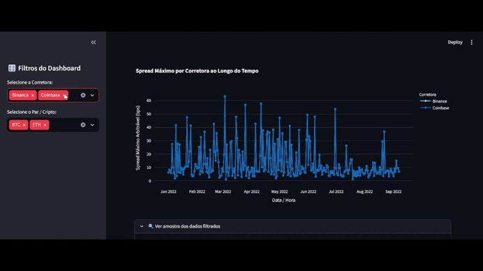

### Link do site no ar: https://arbitragem-de-criptomoedas-c9ohmrlo83nquzunjyw7ey.streamlit.app/

# 📈 Dashboard de Arbitragem & Microestrutura Crypto

Uma aplicação desenvolvida em **Python** e **Streamlit** para explorar dados históricos de spreads entre diferentes corretoras de criptomoedas (*exchanges*).

## 📥 Downloads e Recursos
* **Projeto Compactado:** [Download do Código Fonte (.zip)](../../archive/refs/heads/main.zip)
* **Dataset da Base de Dados:** Ficheiro disponível na pasta `data/cross_exchange_spread.csv`

---

## 🎯 O Problema

No mercado de criptomoedas, o mesmo ativo (como BTC ou ETH) é negociado em dezenas de corretoras simultaneamente. Devido a variações na liquidez, volume local e picos súbitos de volatilidade, surgem diferenças temporárias de preço entre as plataformas — conhecidas como **spreads de arbitragem**.

Identificar essas oportunidades manualmente em tabelas brutas ou logs de dados é inviável por três razões principais:

1. **Volume de dados e ruído:** Milhares de registos de alta frequência geram ruído visual e dificultam a deteção de anomalias.
2. **Falta de visibilidade temporal:** Sem gráficos dinâmicos, é difícil entender a duração desses *spreads* e identificar se foram eventos isolados ou recorrentes.
3. **Dados ausentes/inconsistentes:** Registos brutos costumam vir com falhas (`NaN`/`None`) que poluem a análise rápida.

---

## 💡 A Solução

Este dashboard resolve esse problema transformando microestrutura de mercado bruta num painel interativo e visual:

* **Evolução dos spreads:** Gráfico temporal interativo por ativo, recalculado conforme as corretoras selecionadas e com regimes de mercado identificados por estilo de linha.
* **Filtros combináveis:** Seleção de ativo, corretora, regime de mercado e período.
* **Indicadores do período:** Maior e médio spread bruto, volume de registos e eventos de estresse sem duplicar observações.
* **Destaques históricos:** Tabela com os maiores spreads observados no recorte selecionado.
* **Interface responsiva:** Layout adaptado para ecrãs de computador e dispositivos móveis.
* **Tema escuro:** Fundo, indicadores e gráfico com cores escuras para uma visualização mais confortável.
* **Tratamento de dados:** Conversão de datas e valores numéricos para suportar filtros e gráficos consistentes.

> Os dados são históricos; o spread é recalculado entre as corretoras selecionadas, e não inclui taxas, slippage ou outros custos. Não garante oportunidades executáveis ou lucro.

---

## 📸 Demonstração da Interface



---

## 🛠️ Instalação e Execução

### 1. Clonar o repositório
```bash
git clone 
```

### 2. Instalar as dependências essenciais
```bash
pip install streamlit pandas plotly
```

### 3. Executar a aplicação
```bash
streamlit run app.py
```

---

## 📊 Estrutura dos Dados (`cross_exchange_spread.csv`)

| Coluna Original | Nome no Dashboard | Descrição |
| :--- | :--- | :--- |
| `date` | Data / Hora | Timestamp da captura do registo |
| `symbol` | Par / Cripto | Par de negociação (ex: BTC/USDT) |
| `exchange` | Corretora | Nome da exchange (ex: Binance, Kraken) |
| `max_cross_spread_bps` | Spread Máximo Arbitrável (bps) | Diferença máxima entre corretoras em basis points |
| `shock_event` | Evento de Choque | Deteção de anomalias pontuais no mercado |

---

## 📂 Estrutura do Repositório

```bash
├── data/
│   └── cross_exchange_spread.csv  # Base de dados de arbitragem
├── app.py                         # Aplicação principal Streamlit
└── README.md                      # Documentação
```

---

## 🔮 Próximos Passos (Roadmap)

- [ ] Conexão via WebSocket para dados em tempo real.
- [ ] Cálculo automático de lucros estimados descontando taxas (*fees*) de ordem e saque.
- [ ] Alertas visuais e sonoros quando o *spread* ultrapassar um limite configurável.
